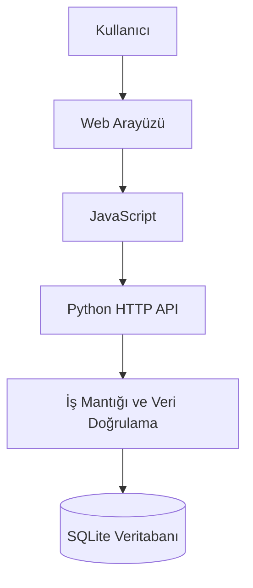

# 📦 Stok ve Envanter Yönetim Sistemi


## 📖 Proje Hakkında

Stok ve Envanter Yönetim Sistemi, küçük işletmelerin ürün kayıtlarını ve stok hareketlerini tek bir web arayüzü üzerinden yönetebilmesi amacıyla geliştirilmiş bir yazılım projesidir.

Sistem, ürün bilgilerinin kaydedilmesini, güncellenmesini, silinmesini ve stok miktarlarının takip edilmesini sağlar.

## 🎯 Projenin Amacı

- Envanter yönetimini dijitalleştirmek.
- Stok takibini kolaylaştırmak.
- Kritik stok seviyelerini belirlemek.
- Ürün yönetiminde oluşabilecek kullanıcı hatalarını azaltmak.
- Basit ve kullanışlı bir yönetim arayüzü sunmak.

## 🚀 Özellikler

- Ürün ekleme ve listeleme
- Ürün bilgilerini güncelleme
- Ürün silme
- Stok giriş ve çıkış işlemleri
- Yetersiz stok kontrolü
- Kritik stok uyarısı
- Ürün adı ve koduna göre arama
- Kategoriye göre filtreleme
- Stok durumuna göre filtreleme
- Birleşik filtreleme
- Toplam stok ve envanter değeri hesaplama
- Otomatik yazılım testleri

## 🛠️ Kullanılan Teknolojiler

| Teknoloji | Kullanım amacı |
|---|---|
| Python | Backend ve iş mantığı |
| SQLite | Veritabanı yönetimi |
| HTML5 | Web arayüzü |
| CSS3 | Arayüz tasarımı |
| JavaScript | Dinamik kullanıcı işlemleri |
| JSON | İstemci-sunucu veri iletişimi |
| unittest | Otomatik yazılım testleri |
| Git | Sürüm kontrolü |
| GitHub | Kaynak kod ve proje yönetimi |

## 🏗️ Sistem Mimarisi



## 📁 Proje Dosya Yapısı

```text
Stok_Envanter_Sistemi/
├── StokEnvanter/
│   ├── app.py
│   ├── static/
│   │   ├── index.html
│   │   ├── style.css
│   │   └── app.js
│   └── tests/
│       └── test_app.py
├── .gitattributes
└── README.md
```

SQLite veritabanı uygulama çalıştırıldığında ihtiyaç halinde otomatik olarak oluşturulur.

## ⚙️ Kurulum ve Çalıştırma

Bilgisayarınızda Python 3 ve Git kurulu olmalıdır.

### 1. Projeyi klonlayın

```bash
git clone https://github.com/alperenkalkan83-create/Stok_Envanter_Sistemi.git
```

### 2. Proje dizinine geçin

```bash
cd Stok_Envanter_Sistemi/StokEnvanter
```

### 3. Uygulamayı çalıştırın

```bash
python app.py
```

### 4. Tarayıcı üzerinden erişin

```text
http://127.0.0.1:8000
```

Proje Python standart kütüphaneleri kullanılarak geliştirildiğinden ek Python paketi kurulumu gerektirmez.

## 🔌 API Uç Noktaları

| Metot | Endpoint | Açıklama |
|---|---|---|
| GET | /api/products | Ürünleri listeleme ve filtreleme |
| POST | /api/products | Yeni ürün ekleme |
| POST | /api/stock | Stok giriş ve çıkışı |
| POST | /api/products/update | Ürün güncelleme |
| POST | /api/products/delete | Ürün silme |

## 📊 Stok Durumları

| Stok miktarı | Durum |
|---|---|
| 0 | Stok tükendi |
| 1–10 | Kritik stok |
| 11 ve üzeri | Yeterli stok |

## 🧪 Yazılım Testleri

Testleri çalıştırmak için:

```bash
python -m unittest discover -s tests -v
```

| Test kategorisi | Test sayısı |
|---|---:|
| Temel ürün işlemleri | 6 |
| Stok giriş ve çıkış | 6 |
| Kritik stok kontrolü | 2 |
| Ürün güncelleme | 6 |
| Ürün silme | 5 |
| Arama ve filtreleme | 9 |
| Toplam | 34 |

Geliştirme aşamasında 34 otomatik test başarıyla tamamlanmıştır.

## 🔒 Veri Doğrulama ve Güvenlik

- Parametreli SQL sorguları
- Benzersiz ürün kodu kontrolü
- Negatif stok miktarının engellenmesi
- Geçersiz fiyat ve miktar kontrolü
- Ürün bilgilerinin sunucu tarafında doğrulanması
- Silme işlemi öncesinde kullanıcı onayı
- Stok işlemlerinde veritabanı transaction kullanımı

Uygulama yerel kullanım için tasarlanmıştır. Kullanıcı kimlik doğrulama ve yetkilendirme sistemi mevcut sürümün kapsamında değildir.

## 📋 Proje Yönetimi

Proje geliştirme süreci GitHub Issues ve GitHub Projects kullanılarak yönetilmiştir.

- [x] Stok giriş ve çıkış
- [x] Kritik stok uyarısı
- [x] Ürün güncelleme
- [x] Ürün silme
- [x] Ürün arama ve filtreleme

## 🔮 Gelecekte Eklenebilecek Özellikler

- Kullanıcı giriş ve yetkilendirme sistemi
- Barkod ve QR kod desteği
- Stok hareket geçmişi
- Excel ve PDF raporlama
- Tedarikçi yönetimi
- Otomatik veritabanı yedekleme
- Çoklu depo yönetimi

## 👨‍💻 Geliştirici

**Alperen Kalkan**

GitHub: [alperenkalkan83-create](https://github.com/alperenkalkan83-create)

---

Stok ve Envanter Yönetim Sistemi
## Proje Yönetim Panosu

Projenin görevleri GitHub Projects üzerinden takip edilmiştir.

[P roje Yönetim Panosu](https://github.com/users/alperenkalkan83-create/projects/2)

## Özelliklerin Denenmesi

### Özellik 1: Stok Giriş ve Çıkış

1. Uygulamayı çalıştırın.
2. Başlangıç stok miktarı 10 olan bir ürün ekleyin.
3. Giriş butonuna basarak 5 adet stok ekleyin.
4. Stok miktarının 15 olduğunu doğrulayın.
5. Çıkış butonuna basarak 3 adet stok çıkarın.
6. Stok miktarının 12 olduğunu doğrulayın.
7. Mevcut stoktan fazla çıkış yapmayı deneyin.
8. Yetersiz stok uyarısının gösterildiğini doğrulayın.

### Özellik 2: Kritik Stok Uyarısı

1. Stok miktarı 15 olan bir ürün oluşturun.
2. Ürünün stok durumunun Yeterli olduğunu doğrulayın.
3. 5 adet stok çıkışı yapın.
4. Kritik stok uyarısının gösterildiğini doğrulayın.
5. Kalan 10 adet stok için çıkış işlemi yapın.
6. Stok tükendi uyarısının gösterildiğini doğrulayın.

## Sürüm

[Release v1.0.0](https://github.com/alperenkalkan83-create/Stok_Envanter_Sistemi/releases/tag/v1.0.0)
